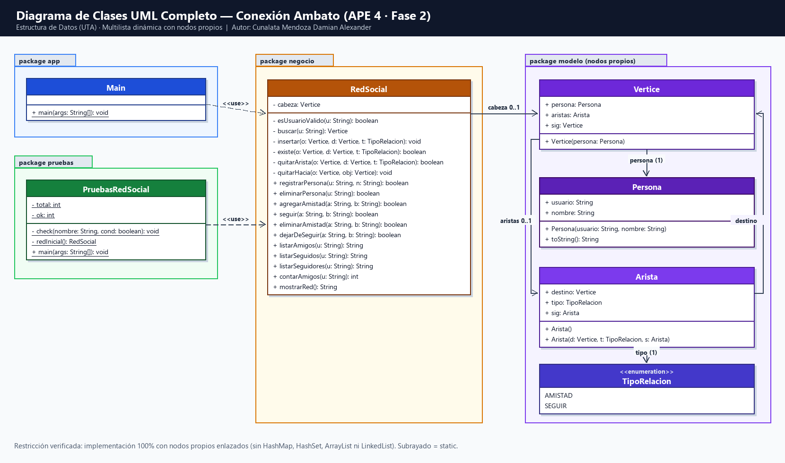

# APE 4 · Fase 2 — Conexión Ambato (Red Social Dinámica con Multilista)

Implementación individual en Java de la evolución de **«Conexión Ambato»** desde el grafo estático de la Fase 1 hacia una **red social dinámica** mediante **listas de adyacencia (multilista) con nodos propios**, sin utilizar colecciones de `java.util` (`HashMap`, `HashSet`, `ArrayList` ni `LinkedList`).

- **Universidad:** Universidad Técnica de Ambato (UTA)
- **Facultad:** Ingeniería en Sistemas, Electrónica e Industrial — Carrera de Software
- **Asignatura:** Estructura de Datos (Tercero "B")
- **Docente:** Ing. José Caiza, Mg.
- **Estudiante:** Cunalata Mendoza Damian Alexander ([`Damienq7w`](https://github.com/Damienq7w))

---

## Arquitectura y Diagrama de Clases UML



### Estructura de paquetes
```text
APE4_Estructura_de_Datos/
├── src/
│   ├── modelo/
│   │   ├── TipoRelacion.java    # Enum AMISTAD (recíproca) y SEGUIR (dirigida)
│   │   ├── Persona.java         # Usuario normalizado en minúsculas y nombre
│   │   ├── Arista.java          # Nodo propio de lista de aristas (destino, tipo, sig)
│   │   └── Vertice.java         # Nodo propio de lista de usuarios (persona, aristas, sig)
│   ├── negocio/
│   │   └── RedSocial.java       # Multilista dinámica y operaciones del modelo (Tabla 2)
│   ├── app/
│   │   └── Main.java            # Ejecución oficial de los 8 pasos de comprobación (Tabla 3)
│   └── pruebas/
│       └── PruebasRedSocial.java # 34 pruebas automatizadas sin dependencias externas
├── evidencias/
│   └── diagrama_clases_completo.png
├── .gitignore
└── README.md
```

---

## Operaciones implementadas y complejidad temporal (Tabla 4)

| Operación | Retorno | Complejidad | Descripción |
| :--- | :---: | :---: | :--- |
| `registrarPersona(u, n)` | `boolean` | $O(V)$ | Normaliza `u` a minúsculas; rechaza vacío, espacios, comas y duplicados |
| `eliminarPersona(u)` | `boolean` | $O(V + A)$ | Limpia todas las aristas entrantes en toda la red antes de desenlazar el vértice |
| `agregarAmistad(a, b)` | `boolean` | $O(V + \text{grado})$ | Inserta 2 aristas `AMISTAD` (recíproca); sin lazos ni duplicados |
| `seguir(a, b)` | `boolean` | $O(V + \text{grado})$ | Inserta 1 arista dirigida `SEGUIR` (`a -> b`); sin lazos ni duplicados |
| `eliminarAmistad(a, b)` | `boolean` | $O(V + \text{grado})$ | Retira ambas aristas `AMISTAD` |
| `dejarDeSeguir(a, b)` | `boolean` | $O(V + \text{grado})$ | Retira únicamente la arista dirigida `SEGUIR` |
| `listarAmigos(u)` / `listarSeguidos(u)` | `String` / `null` | $O(V + \text{grado})$ | Recorre la lista propia del vértice; devuelve `null` si no existe |
| `listarSeguidores(u)` | `String` / `null` | $O(V + A)$ | Recorre todos los vértices y aristas buscando quién sigue a `u` |
| `contarAmigos(u)` | `int` | $O(V + \text{grado})$ | Devuelve el grado de amistad o `-1` si el usuario no existe |
| `mostrarRed()` | `String` | $O(V + A)$ | Recorre todos los vértices y aristas mostrando el resumen completo |

---

## Secuencia de comprobación verificada (Tabla 3)

1. Registro de `A01`–`A06` (Sofía, Mateo, Valeria, Andrés, Camila, Diego) y las 5 amistades iniciales → **6 usuarios, 5 amistades (10 aristas internas), grados `2, 2, 2, 3, 1, 0`**.
2. `seguir("A02", "A01")` → Mateo aparece entre los seguidores de Sofía.
3. `seguir("A06", "A01")` → Diego sigue a Sofía aunque tenga 0 amigos.
4. `listarAmigos("A04")` → Camila, Sofía y Valeria (orden de inserción al inicio).
5. `eliminarAmistad("A04", "A05")` → Andrés pierde a Camila y viceversa.
6. `eliminarPersona("A01")` → Se borra Sofía y todas las referencias entrantes (`AMISTAD` y `SEGUIR`).
7. `registrarPersona("A02", "Otro Nombre")` → `false` (duplicado rechazado).
8. `agregarAmistad("A03", "A03")` → `false` (lazo no permitido).

---

## Compilación y ejecución (PowerShell)

```powershell
# Compilar todo el proyecto
javac -encoding UTF-8 -d out (Get-ChildItem -Recurse -Filter *.java src).FullName

# Ejecutar secuencia oficial de comprobación (Tabla 3 — Anexos 1 a 4)
java -cp out app.Main

# Ejecutar pruebas automatizadas (Anexo 5 — 34/34 pruebas superadas)
java -cp out pruebas.PruebasRedSocial
```
